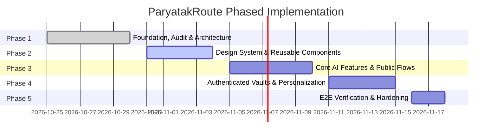

# ParyatakRoute — Phased Development Roadmap

> **Authoritative References:** `DESIGN.md`, `PROJECT_ARCHITECTURE.md`, `FRONTEND_STRUCTURE.md`, `DESIGN_SYSTEM.md`, `PAGE_COMPONENT_MAPPING.md`, `API_INTEGRATION_MAP.md`.  
> **Target:** Robust, production-grade implementation of ParyatakRoute adhering to the Hopper-inspired design system and connecting to the live FastAPI backend with zero-friction public AI access.

---

## Roadmap Overview

---

## Phase 1: Foundation, Audit & Architecture (COMPLETE)

### Objectives
Audit codebase, analyze live API contracts, establish frontend stack, adapt `DESIGN.md` tokens, verify unauthenticated AI access, and produce architectural documentation.

### Completed Milestones
- [x] Full codebase audit of `backend-fastapi` models, schemas, Groq AI pipeline, and live endpoints at `https://paryatakrouteapi.itspranjal.in/api/v1`.
- [x] Unauthenticated AI generation and chatbot support verified via `GUEST_USER_ID = "60ac5770-df60-402e-9374-79ba6c0c1b72"`.
- [x] Vite + React 19 + TypeScript + React Router initialized with pure CSS tokens.
- [x] Produced all 6 core architecture deliverables:
  1. `PROJECT_ARCHITECTURE.md`
  2. `FRONTEND_STRUCTURE.md`
  3. `DESIGN_SYSTEM.md`
  4. `PAGE_COMPONENT_MAPPING.md`
  5. `API_INTEGRATION_MAP.md`
  6. `DEVELOPMENT_ROADMAP.md`

---

## Phase 2: Design Tokens & Reusable Component System

### Objectives
Implement the complete component library adhering strictly to `DESIGN.md` visual rules before wiring business logic.

### Tasks
1. **Design Tokens & Theme Foundation:**
   - Establish CSS variables in `src/index.css` (`--color-hopper-blue: #1878ec`, `--color-cloud: #f6f6f6`, `--color-mist: #ededed`, etc.).
   - Configure Nunito Sans typography scale and 4px spatial units.
   - Establish strict border radius rules (0px inputs, 9999px search pill, 32px hero/promo, 16px cards, 12px compact controls).
2. **Navigation Suite:**
   - `HeroNav`: Transparent navigation embedded over photographic hero with white text, mode tabs, and outline sign-in button.
   - `Navbar`: Sticky standard header for internal pages on `#ffffff` canvas with 1px border.
   - `Footer`: Global footer featuring `#ededed` band, 4-column destination links, and legal info.
3. **Search & Filter Controls:**
   - `SearchPill`: 9999px unified white search bar with 1px dividers, 0px input fields, date picker popover, travelers counter, and circular `#1878ec` button.
   - `DestinationAutocomplete`: Debounced dropdown querying `GET /destinations`.
   - `FilterBar`: Category filter pills (Heritage, Nature, Beach, Mountain, Budget).
4. **Cards & Visual Containers:**
   - `DestinationCard`: Flat `#f6f6f6` card with 16px radius, no box shadow, 1px border, bookmark button.
   - `PromoTile`: Full-bleed `#1878ec` banner with 32px radius and white pill CTA.
   - `AppDownloadShowcase`: 32px bold heading, QR code, and overlapping mobile screenshots.
5. **Interactive Modals & Drawers:**
   - `AuthModal`: Tabbed login/register modal using Supabase Auth without blocking guest exploration.
   - `ChatDrawer`: Floating expandable chat assistant mounted globally.

### Deliverables & Acceptance Criteria
- Component Storybook or demonstration page showcasing all atomic components.
- Zero drop shadows across cards and promo banners.
- Search inputs have 0px internal radii inside the 9999px pill.
- Clean TypeScript compilation with zero lint errors.

---

## Phase 3: Core AI Features & Unauthenticated Flows

### Objectives
Wire public-facing features allowing all visitors to explore, generate travel itineraries with Groq AI, regenerate single days surgically, and chat with the AI assistant without logging in.

### Tasks
1. **Homepage Assembly:**
   - Mount `HeroNav`, 32px photographic hero, `SearchPill`, deal card grid, blue promotional banner, app showcase, and link directory.
   - Wire search submission directly to `/trips/create` or `/explore`.
2. **Explore Page (`/explore`):**
   - Connect real-time Nominatim search (`/destinations`) and category filter state.
   - Render responsive card grid with live Open-Meteo weather badges (`/weather`).
3. **Trip Creation Wizard (`/trips/create`):**
   - Implement multi-step flow (Destination & Dates, Traveler Persona, Budget & Pace).
   - Wire form submission to `POST /itineraries/generate` with guest fallback.
   - Render animated loading state with Groq AI generation status.
4. **Itinerary Viewer (`/itineraries/:id`):**
   - Render day-by-day accordion cards with morning, afternoon, and evening timelines.
   - Connect `BudgetBreakdownChart` to `GET /itineraries/:id/budget`.
   - Implement **Surgical Day Regeneration** modal calling `POST /itineraries/:id/days/:day/regenerate`.
   - Add PDF export download calling `GET /itineraries/:id/export/pdf`.
5. **AI Chatbot Experience (`/chat` & Global Drawer):**
   - Wire conversational UI to `POST /chat`.
   - Support conversation history, markdown rendering, and travel suggestion chips.
   - Ensure complete operation without authentication prompts.

### Deliverables & Acceptance Criteria
- Unauthenticated visitor can generate an itinerary from start to finish.
- Regenerating Day 2 updates only Day 2 without affecting other days or causing 401 errors.
- PDF download works seamlessly in browser.
- Chat drawer responds with Groq AI advice without login requirement.

---

## Phase 4: Authenticated Traveler Vaults & Personalization

### Objectives
Enable user registration, login, token refresh, personal trip management, bookmarking, and profile preferences with strict BOLA isolation.

### Tasks
1. **Authentication State & Session Sync:**
   - Integrate Supabase Auth via `POST /auth/register`, `POST /auth/login`, `POST /auth/refresh`.
   - Implement automatic token rotation in Axios interceptor.
   - Build silent claim utility: transfer guest itineraries created before login into user's account.
2. **My Trips Dashboard (`/trips`):**
   - Display list of user trips with pagination via `GET /trips`.
   - Enable trip renaming, date adjustments, and deletion with confirmation dialog (`DELETE /trips/:id`).
3. **Saved Destinations Wishlist (`/favourites`):**
   - Bookmark button on `DestinationCard` persists to `POST /favourites`.
   - Dedicated `/favourites` page to review saved destinations and trigger quick itinerary generation.
4. **Profile & Account Settings (`/profile`):**
   - User profile details via `GET /auth/me`.
   - Preference toggles: default currency (INR, USD, EUR, GBP), unit system, and dietary defaults.

### Deliverables & Acceptance Criteria
- Registered users can view their saved trips while guests see prompt to save their session.
- Strict BOLA checks verified: User A cannot read or delete User B's trips.
- Refresh token silently renews expired access tokens without interrupting the user.

---

## Phase 5: Verification, E2E Testing & Hardening

### Objectives
Conduct thorough testing, responsive design validation across mobile and desktop, performance optimization, and deployment readiness checks.

### Tasks
1. **End-to-End Journey Verification:**
   - Test guest itinerary generation -> single day regeneration -> PDF download -> registration -> claimed trip persistence.
   - Verify chatbot context retention during trip browsing.
2. **Responsive Audit:**
   - Mobile (< 768px): Test collapsed search pill, horizontal scrollable tabs, stacked cards.
   - Tablet (768px - 1024px): Verify 2-column card layouts and fluid touch interactions.
   - Desktop (> 1024px): Validate 32px hero container, 9999px search pill, 4-column link directory.
3. **Performance & Security Hardening:**
   - Lighthouse score audit: ensure > 90 for Performance, Accessibility, and Best Practices.
   - Verify rate limiting handling (`429 Too Many Requests`) with user-friendly countdown toast.
   - Clean up bundle size; lazy load Leaflet map and heavy visualization components.

### Deliverables & Acceptance Criteria
- 100% test pass rate across unit and integration suites.
- Verified zero console errors and zero broken layout states.
- Production build passes with zero TypeScript errors.
