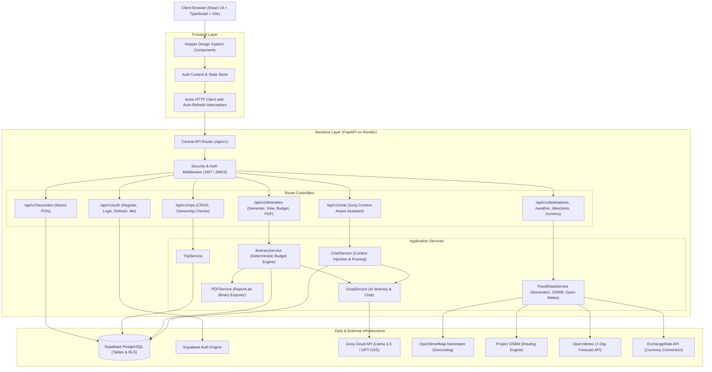

# ParyatakRoute — Project Architecture Specification (Phase 1)

**Project Name:** ParyatakRoute  
**Version:** 1.0.0 (Phase 1: Foundation, Audit & Architecture)  
**Document Status:** Complete & Authoritative  
**Authoritative References:**
- Primary UI/UX Design System: `DESIGN.md` (Hopper-inspired architectural travel interface adapted for ParyatakRoute)
- Backend Implementation: [https://github.com/pranjal-shrivastava-78/ParyatakRoute](https://github.com/pranjal-shrivastava-78/ParyatakRoute)
- Live API Contract: [https://paryatakrouteapi.itspranjal.in/docs](https://paryatakrouteapi.itspranjal.in/docs)

---

## 1. System Overview & Core Capabilities

ParyatakRoute is an intelligent, personalized travel itinerary planner and real-time geospatial discovery engine. The application transforms user travel parameters (destination, duration, budget, travel pacing, party size, and multi-faceted interests) into structured day-by-day travel schedules with approximate cost breakdowns, verified geospatial points of interest (POIs), turn-by-turn driving durations, live weather forecasts, deterministic budget calculations with overrun alerts, downloadable ReportLab PDFs, and an interactive AI travel chatbot.

### Core Architectural Pillars
1. **Stateless Backend Architecture:** FastAPI ASGI service hosted on Render, exposing standardized versioned REST routes under `/api/v1` with root-level `/health` liveness probes.
2. **Cryptographic Identity & Row-Level Authorization:** Supabase Auth JWT bearer authentication (asymmetric JWKS and symmetric HS256 verification) coupled with PostgreSQL Row-Level Security (RLS) enforcing strict Broken Object Level Authorization (BOLA) guarantees.
3. **Public AI Access Strategy:** Unauthenticated visitor access for AI itinerary generation and the AI travel chatbot (leveraging `GUEST_USER_ID = "60ac5770-df60-402e-9374-79ba6c0c1b72"` for database consistency), while reserving private vaults for registered user trips, saved favorites, and personal profiles.
4. **Deterministic Geospatial & Financial Calculations:** Business calculations (budget breakdowns across Transport, Accommodation, Food, Activities, and Miscellaneous, currency conversions, and driving durations) are computed deterministically in Python/TypeScript rather than delegated to hallucination-prone LLMs.
5. **LLM Cost & Token Optimization:** Groq AI Cloud integration (utilizing `openai/gpt-oss-120b` and `openai/gpt-oss-20b`) with in-flight request deduplication locks, 15-minute privacy-safe response caching, and surgical single-day regeneration saving up to ~78% tokens per itinerary iteration.

---

## 2. End-to-End System Architecture

---

## 3. Technology Stack Audit & Selection

### Backend Technology Stack (Verified in Workspace)
- **Runtime:** Python 3.13
- **Framework:** FastAPI 0.115+ (ASGI framework with async route handlers)
- **Data Validation & Contracts:** Pydantic v2 (Strict BaseModel schemas with `model_validator`)
- **Database & Persistence:** Supabase PostgreSQL with PostgREST, Row-Level Security (RLS), and database triggers (`handle_updated_at`, `handle_new_user`)
- **Authentication:** Stateless Supabase JWTs with asymmetric PyJWKClient decoding and symmetric HS256 fallback
- **AI Engine:** Official Groq SDK (`groq-python`) invoking high-throughput models (`openai/gpt-oss-120b` and `openai/gpt-oss-20b`)
- **Document Generation:** ReportLab 4.x for automated binary multi-page travel itinerary PDFs
- **Testing:** Pytest 8.4 with `pytest-asyncio` (54 tests passing, covering security edge cases, BOLA isolation, AI resilience, and unauthenticated public flows)

### Frontend Technology Stack (Finalized)
- **Core Library:** React 19 + TypeScript (Strict mode, ES2023)
- **Build Tool:** Vite 8.3 (Fast HMR, optimized production rollup bundling)
- **Routing:** React Router v7 (Declarative client-side routing, query parameter synchronization)
- **Styling Architecture:** Vanilla CSS Design System with CSS Custom Properties and Tailwind CSS tokens adhering directly to `DESIGN.md` (no unverified utility abstractions)
- **Typography:** Google Fonts **Nunito Sans** (Primary Proxima Nova substitute per DESIGN.md: weights 400, 600, 700, 800)
- **HTTP Client:** Axios 1.21+ with centralized request authorization headers and 401 token refresh queue interceptors
- **Icons:** `lucide-react` (Compact, lightweight line iconography matching DESIGN.md navigation, search, and utility button specs)

---

## 4. Environment & Deployment Configuration

### Frontend Configurations
- **Development Base URL:** `http://localhost:8000/api/v1` (or local fallback)
- **Production Base URL:** `https://paryatakrouteapi.itspranjal.in/api/v1`
- **Configuration File:** `.env` and `.env.example` using `VITE_API_BASE_URL`

### Backend Configurations (`backend-fastapi/.env`)
- `APP_ENV`: `development` | `production` | `test`
- `PORT`: `8000` (Render binds to `$PORT`)
- `CORS_ALLOWED_ORIGINS`: `http://localhost:5173,http://localhost:3000,https://paryatakroute.vercel.app`
- `SUPABASE_URL`: Remote Supabase project URL (`https://ygfksgxttlcwaruzwoch.supabase.co`)
- `SUPABASE_SERVICE_ROLE_KEY`: Secret service role key for administrative persistence
- `SUPABASE_JWT_SECRET`: Secret key for HS256 symmetric JWT validation
- `GROQ_API_KEY`: API key for Groq AI inference
- `GROQ_MODEL`: Primary itinerary generation model (`openai/gpt-oss-120b`)
- `GROQ_CHAT_MODEL`: Conversational assistant model (`openai/gpt-oss-20b`)
- `render.yaml`: Root infrastructure configuration for deploying the FastAPI Web Service on Render.

---

## 5. Security & Data Protection Architecture

1. **Broken Object Level Authorization (BOLA) Protection:**
   - Every read, update, and delete operation on `/api/v1/trips/{trip_id}`, `/api/v1/itineraries/{itinerary_id}`, and `/api/v1/favourites/{id}` validates caller ownership against `user_id`.
   - Access attempts to other users' private trips return `403 FORBIDDEN` or `404 NOT_FOUND`.
2. **Public Feature Safe Separation:**
   - Public features (Itinerary Generation, Itinerary Viewing, Budget Inspection, PDF Export, and AI Travel Chat) accept unauthenticated requests without throwing `401 UNAUTHORIZED`.
   - When an unauthenticated visitor plans an itinerary, the record is associated with `GUEST_USER_ID`, preventing foreign key constraint violations while keeping private user trips isolated.
3. **No Frontend Credential Leakage:**
   - The frontend never receives or stores `GROQ_API_KEY`, `SUPABASE_SERVICE_ROLE_KEY`, or `SUPABASE_JWT_SECRET`.
   - All AI synthesis and geocoding queries are proxied through backend controllers with input sanitization and Pydantic validation.
4. **Token Refresh Interceptor Cycle:**
   - On encountering a `401 TOKEN_EXPIRED`, Axios transparently queues incoming concurrent requests, issues a single call to `POST /api/v1/auth/refresh`, updates access tokens in `localStorage`, and retries the queued requests without user disruption.
